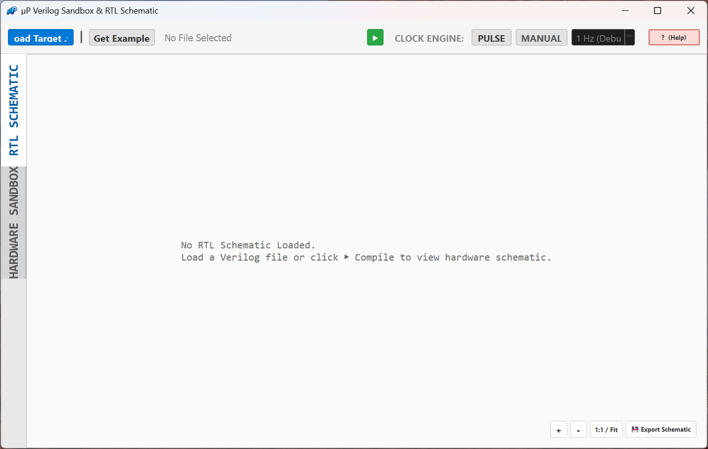
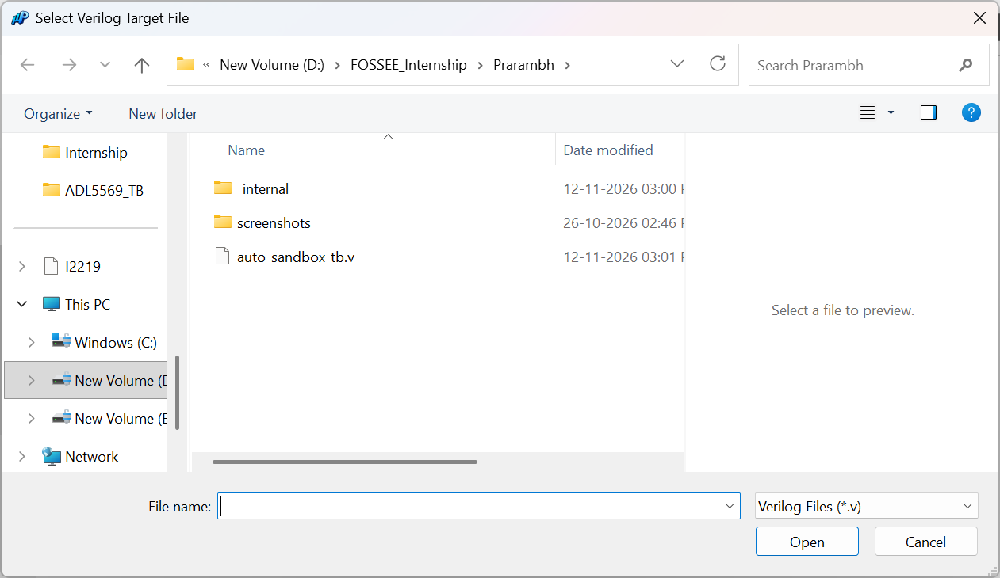
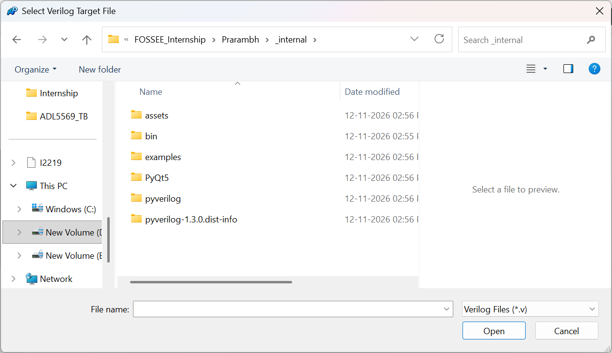
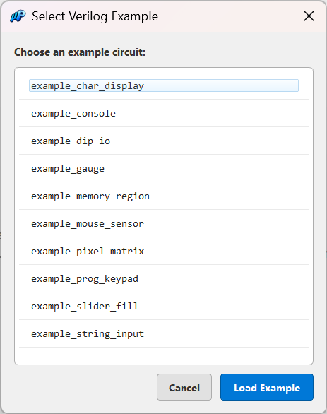
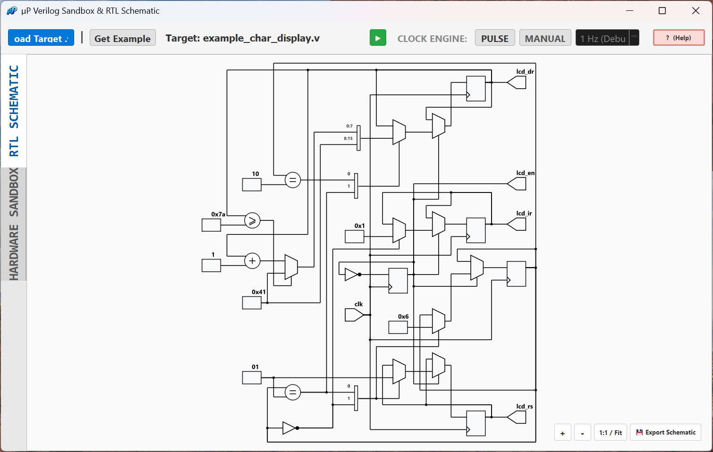
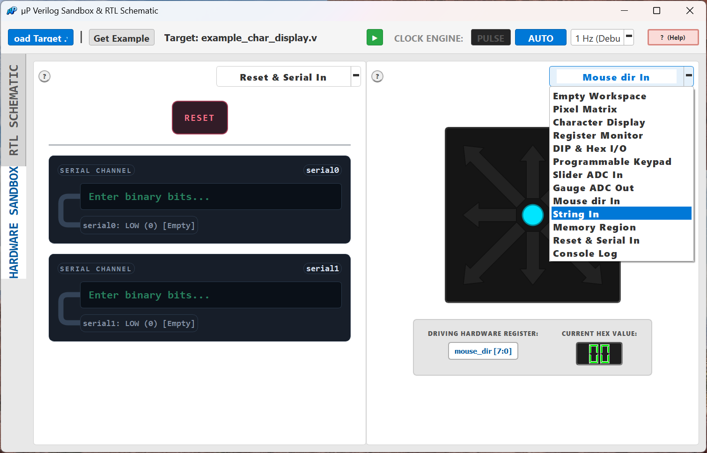
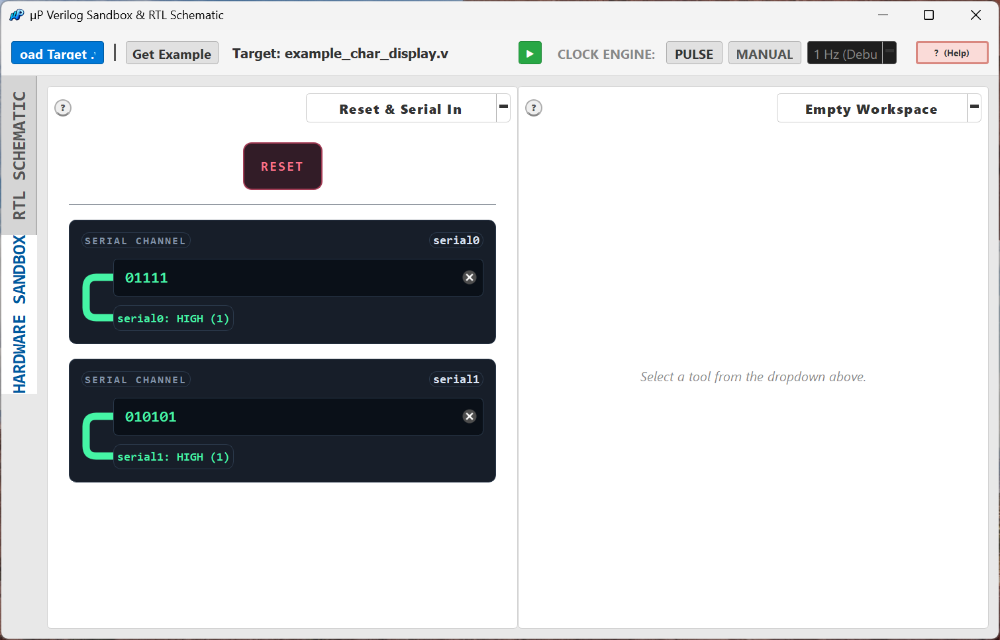
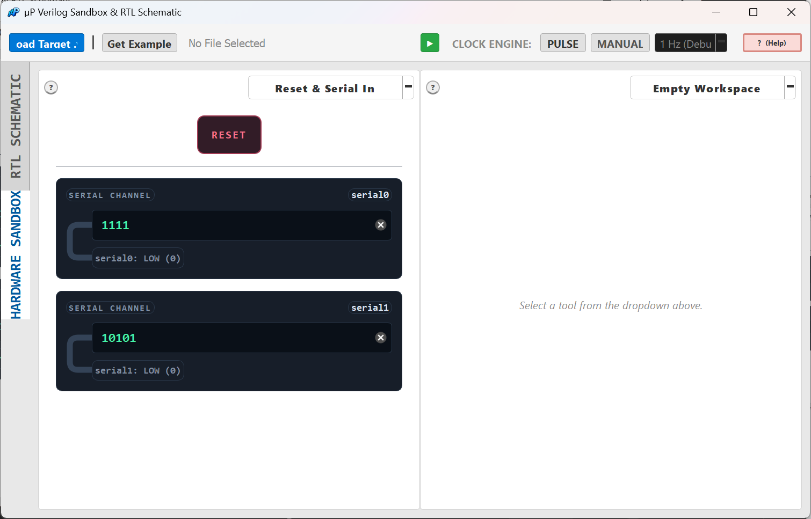
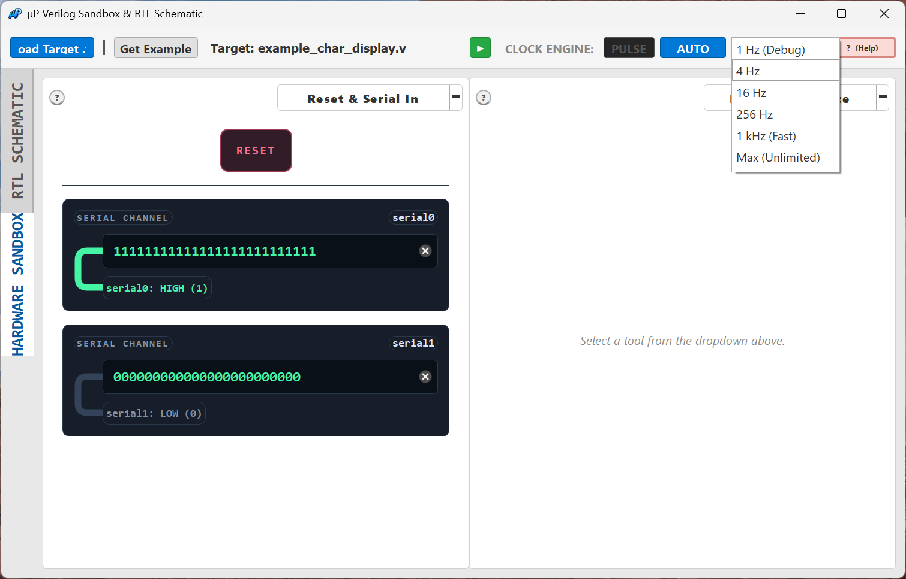

# μP PRARAMBH Verilog Sandbox & RTL Schematic: User Guide

A structured, step-by-step reference detailing the shared top controls, view modes and modular virtual peripherals of the **μP Verilog Sandbox & RTL Schematic** environment.

> **Quick Start Workflow:**
> 1. **Load a Design**: Click **Load Target** to import your own `.v` file from your PC or click **Get Example** to pick a pre-installed circuit.
> 2. **Compile**: Click **▶ (Compile / Run)** to elaborate the Verilog module and generate its RTL schematic.
> 3. **Inspect Hardware**: View the structural block diagram in the **RTL SCHEMATIC** tab (zoom, fit or export as `.svg`, `.pdf` or `.png`).
> 4. **Simulate & Test**: Switch to **HARDWARE SANDBOX**, assign up to two virtual peripherals and drive the circuit using **MANUAL (`PULSE`)** or **AUTO** clock modes.

---

## 1. Global Top Control Bar (Shared Across All Views)

The top toolbar remains persistent and identical whether you are working in the **RTL SCHEMATIC** view or the **HARDWARE SANDBOX** view:

- **Load Target**: Opens your PC's file explorer to browse and import any custom Verilog HDL source file (`*.v`) stored anywhere on your computer, including external projects.
- **Get Example**: Opens the built-in catalog of pre-installed reference Verilog circuits bundled with the application for quick testing.
- **Active File Indicator**: Displays the currently loaded Verilog module (e.g., `No File Selected` or `Target: example_char_display.v`).
- **Compile / Run (`▶`)**: Elaborates the active Verilog design to generate the hardware schematic and initialize the simulation engine.
- **Clock Engine**:
  * **PULSE**: Advances the simulation by a single discrete clock edge (`posedge clk`).
  * **MANUAL / AUTO Mode Toggle**: Switch between **MANUAL** mode (step-by-step user-controlled clocking) and **AUTO** mode (continuous automated clock cycling).
  * **Frequency Selector**: Configures the `AUTO` clock speed (`1 Hz (Debug)`, `4 Hz`, `16 Hz`, `256 Hz`, `1 kHz (Fast)` and `Max (Unlimited)`).
- **`? (Help)`**: Opens this complete user manual covering the entire **μP Verilog Sandbox & RTL Schematic** application (distinct from the smaller **`?`** buttons inside each Hardware Sandbox slot, which provide guidance only for the individual virtual hardware tool loaded in that bay).

---

## 2. Primary Workspace Views (Left Sidebar Switcher)

Switch between structural hardware inspection and interactive circuit simulation using the two tabs on the left vertical sidebar:

### 2.1 RTL Schematic View (`RTL SCHEMATIC`)

- **Purpose**: Displays the synthesized register-transfer and gate-level hardware diagram of your active Verilog design.
- **Empty State**: Prior to compilation, the canvas prompts: *"No RTL Schematic Loaded. Load a Verilog file or click ▶ Compile to view hardware schematic."*
- **Viewport & Export Controls (Bottom Right)**:
  * **`+` / `-`**: Zoom in and out of the schematic diagram.
  * **`1:1 / Fit`**: Scales and centers the entire schematic inside the viewport.
  * **`Export Schematic`**: Exports the rendered hardware schematic diagram in **`.svg`**, **`.pdf`** or **`.png`** format.

### 2.2 Hardware Sandbox View (`HARDWARE SANDBOX`)

- **Purpose**: An interactive testing workbench featuring **two independent, side-by-side peripheral slots**.
- **Concurrent Multi-Tool Operation**: Both bays operate simultaneously, allowing you to load and use two different virtual hardware tools at the same time (for example, pairing an input stimulus tool on the left with a display or memory monitor on the right).
- **Slot Controls**:
  * **Peripheral Selector Dropdown**: Assigns any available virtual hardware tool to that specific bay.
  * **Tool-Specific Help (`?`)**: Located at the top-left of each slot. Unlike the global **`? (Help)`** button in the top toolbar, clicking a slot's **`?`** button opens a dedicated **Learner Guide** exclusively for the virtual hardware tool currently occupying that bay, detailing its port connections and operating rules.
  * **Panel Minimize (`-`)**: Collapses or expands the peripheral bay.

---

## 3. Loading Verilog Files & Built-in Examples

### 3.1 Loading a Custom Target File (`Load Target`)

<table>
  <tr>
    <td align="center">
       
      <b>Root & Project Directory</b>
    </td>
    <td align="center">
       
      <b>Internal Environment Assets (<code>_internal/</code>)</b>
    </td>
  </tr>
</table>

- **Root & Project Navigation**: Browse local drives and project directories (such as `auto_sandbox_tb.v`) filtered for Verilog (`*.v`) files.
- **Internal Environment Assets (`_internal/`)**: Inspect bundled directories (`assets/`, `bin/`, `examples/`, `PyQt5/`, `pyverilog/`) with a live text preview pane on the right before opening.

### 3.2 Selecting a Built-in Example (`Get Example`)

Click **Get Example** and select **Load Example** to load pre-configured reference designs:
- **`example_char_display`**: ASCII text matrix decoder and LCD emulator.
- **`example_console`**: Serial terminal printing and `$display` log parsing.
- **`example_dip_io`**: Multi-bit DIP switch bank and LED status register verification.
- **`example_memory_region`**: SRAM/ROM block read, write and address indexing.
- **`example_mouse_sensor`**: 2D pointer displacement and directional register inputs.
- **`example_pixel_matrix`**: Framebuffer matrix memory mapping and pixel manipulation.
- **`example_prog_keypad`**: Matrix keypad scanning, debouncing and keycode decoding.
- **`example_string_input`**: Serial UART packet assembly and string buffer parsing.

---

## 4. Inspecting the Synthesized RTL Schematic

- **Netlist Elaboration**: After selecting a target (e.g., `Target: example_char_display.v`) and clicking **Compile (`▶`)**, the tool renders synthesized D flip-flops, multiplexers, arithmetic adders (`+`), comparators (`=`, `≥`), inverters and bit-slice buses (`0:7`, `8:15`).
- **Port & Constant Mapping**: Displays top-level input pins (`clk`), constant values (`0x41`, `0x7a`, `10`, `01`) and output pins (`lcd_dr`, `lcd_en`, `lcd_ir`, `lcd_rs`).

---

## 5. Configuring & Using Sandbox Virtual Peripherals

Select any virtual hardware tool from either slot's dropdown menu to assign it to that workspace bay (click the slot's top-left **`?`** button for that tool's dedicated Learner Guide):

| Virtual Hardware Tool | Direction / Role | Primary Function & Port Mapping |
| :--- | :--- | :--- |
| **`Empty Workspace`** | Unassigned | Leaves the peripheral bay blank. |
| **`Reset & Serial In`** | Input Stimulus | Triggers temporary active-high `RESET` and shifts MSB-first binary streams (`serial0`, `serial1`). |
| **`Mouse dir In`** | Input Stimulus | Maps physical mouse movement clockwise onto the 8-bit `mouse_dir [7:0]` bus (`0x00` when idle). |
| **`DIP & Hex I/O`** | Bidirectional I/O | Drives two 8-bit DIP switch inputs (`port_a [7:0]`, `port_b [7:0]`) and monitors a 16-bit output (`out_monitor [15:0]`) on LEDs and hex displays[cite: 3]. |
| **`Programmable Keypad`** | Input Stimulus | Macro keypad (`CMD_1`–`CMD_F`) where right-clicking maps any keycap to a detected top-module input port and hex value and left-clicking transmits it live[cite: 4]. |
| **`String In`** | Input Stimulus | Packs up to 16 typed ASCII characters into an 8-bit-per-character bitvector bus (e.g., `string_in [127:0]`) when **UPDATE STRING REGISTER** is clicked[cite: 5]. |
| **`Character Display`** | Output Monitor | Emulates an HD44780 character LCD controller driven by `lcd_ir [7:0]`, `lcd_dr [7:0]`, `lcd_rs` and rising-edge `lcd_en` pulses[cite: 6]. |
| **`Pixel Matrix`** | Output Monitor | Visualizes a 16×16 (256-LED) grid mapped to a 256-bit `pixel_matrix [255:0]` output bus (Bit `0` at `(0,0)` to Bit `255` at `(15,15)`)[cite: 7]. |
| **`Register Monitor`** | Output Monitor | Dynamic signal probe that scans declared signals and displays live HEX and BIN readouts formatted to each signal's static bit width[cite: 8]. |
| **`Memory Region`** | Memory Inspector | External RAM inspector that snoops write control signals (`we`, `addr`, `wdata`) to highlight updated byte cells and inspect hex/binary contents[cite: 9]. |
| **`Console Log`** | Output Monitor | System terminal capturing `[INFO]`, `[SUCCESS]`, `[ERROR]` and raw `[Verilog]` `$display` output logs[cite: 10]. |

### Dual-Slot Active Peripheral Example

In the configuration above, two different virtual hardware tools run concurrently across the workbench:

- **Left Slot — `Reset & Serial In`**:
  * **System Reset (`RESET`)**: Sends a temporary high reset signal to initialize sequential logic in your Verilog design.
  * **MSB-First Serial Input Streaming (`serial0` & `serial1`)**: Type binary sequences (`0`s and `1`s) into each input field. On every positive clock edge (via `PULSE` or `AUTO`), the leftmost bit (MSB) is consumed and driven onto the respective wire, while the remaining bits automatically shift left for the next cycle.
  * **Live Wire Indicators**: Status labels update in real time and highlight in green whenever the currently transmitted bit is `1`.
- **Right Slot — `Mouse dir In`**:
  * **Physical Mouse Tracking**: Tracks your physical computer mouse movement and maps its 8-way directional vector clockwise onto the 8-bit `mouse_dir [7:0]` input bus (`0x01` North, `0x02` North-East, `0x04` East, `0x08` South-East, `0x10` South, `0x20` South-West, `0x40` West, `0x80` North-West).
  * **Idle State & Hex Readout**: When the mouse rests completely, the register zeroes out (`0x00`), the center ring illuminates and the 7-segment display shows the instantaneous hexadecimal bus value.

---

## 6. Clock Stepping & Execution Modes (`MANUAL` vs `AUTO`)

The **Clock Engine** in the top control strip allows you to switch between manual single-step debugging and continuous automated clocking.

### 6.1 Manual Mode (`MANUAL` + `PULSE`)

<table>
  <tr>
    <td align="center">
       
      <b>Step 1: Entering Serial Bitstreams (<code>01111</code> / <code>010101</code>)</b>
    </td>
    <td align="center">
       
      <b>Step 2: Updating Bits & Stepping via <code>PULSE</code></b>
    </td>
  </tr>
</table>

- **Purpose**: Pauses automatic clock cycling so all circuit state transitions are strictly controlled by the user.
- **Single-Step Execution (`PULSE`)**: Click **PULSE** to trigger one discrete rising clock edge (`posedge clk`) at a time.
- **Workflow**: Ideal for entering specific binary bit patterns into `serial0` and `serial1` (`01111`, `010101` $\rightarrow$ `1111`, `10101`) and tracing bit-by-bit shifts or register updates cycle-by-cycle.

### 6.2 Auto Mode (`AUTO` + Frequency Presets)

- **Purpose**: Continuously drives the hardware clock at a selected frequency without manual button presses.
- **Frequency Dropdown Presets**:
  * **`1 Hz (Debug)`**: 1 cycle per second; ideal for visual observation of live signal transitions.
  * **`4 Hz` / `16 Hz`**: Low-speed automated execution for counter and state-machine verification.
  * **`256 Hz`**: Real-time refresh rate for multiplexed displays and keypad scanning.
  * **`1 kHz (Fast)`**: High-speed execution for memory transfers and multi-cycle operations.
  * **`Max (Unlimited)`**: Uncapped clock speed driven by maximum host CPU capacity.
- **Workflow**: Select **AUTO** to stream long serial bitstreams (`serial0`, `serial1`) continuously into the active design while observing live output updates.
