# μP PRARAMBH Verilog Sandbox & Visual Builder: User Guide

A complete, step-by-step user manual detailing the operational workflow, purpose, configuration, and interface elements of the **μP Verilog Sandbox & Visual Builder** environment.

---

## 1. Application Launch & Default Hardware Sandbox

When first launching the software, the environment initializes into the **HARDWARE SANDBOX** view with default diagnostic modules.

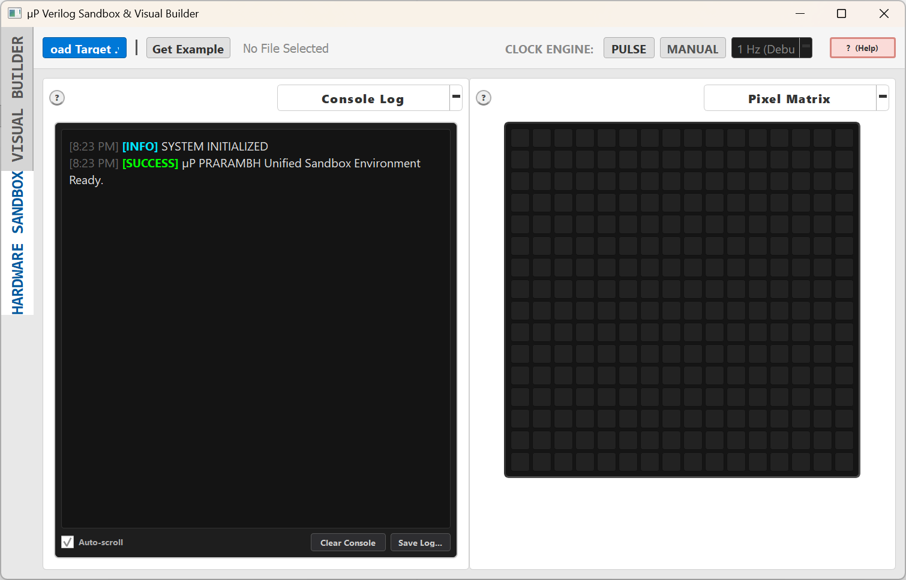

### Purpose & Elements:
* **Primary View Switcher (Left Sidebar)**:
  * **HARDWARE SANDBOX**: Interactive testing workbench for running simulations, wiring virtual peripherals, and monitoring memory/signals.
  * **VISUAL BUILDER**: Graphical programming canvas to model digital circuits, datapath logic, and finite state machines.
* **Top Control Strip**:
  * **Load Target**: Opens the file manager to import custom circuit descriptions (`.v` or `.xml`).
  * **Get Example**: Provides an immediate gallery of ready-to-simulate reference hardware projects.
  * **Status Indicator**: Shows the active loaded circuit file (e.g., `No File Selected`).
  * **Clock Engine**: Controls simulation timing via `PULSE`, `MANUAL`, and `AUTO` frequency states.
  * **Help (`?`)**: Displays system reference and documentation.
* **Left Slot (`Console Log`)**:
  * Streams system notices, parser messages, compilation status, and simulation run logs.
  * Includes **Auto-scroll** toggle, **Clear Console**, and **Save Log...** to export execution transcripts.
* **Right Slot (`Pixel Matrix`)**:
  * A 2D addressable LED/pixel grid display widget for raster graphics, display controller outputs, and memory framebuffers.

---

## 2. Browsing & Loading Hardware Description Files

You can load your own HDL modules or open saved visual builder graphs into the environment.

### 2.1 File Explorer Root Navigation

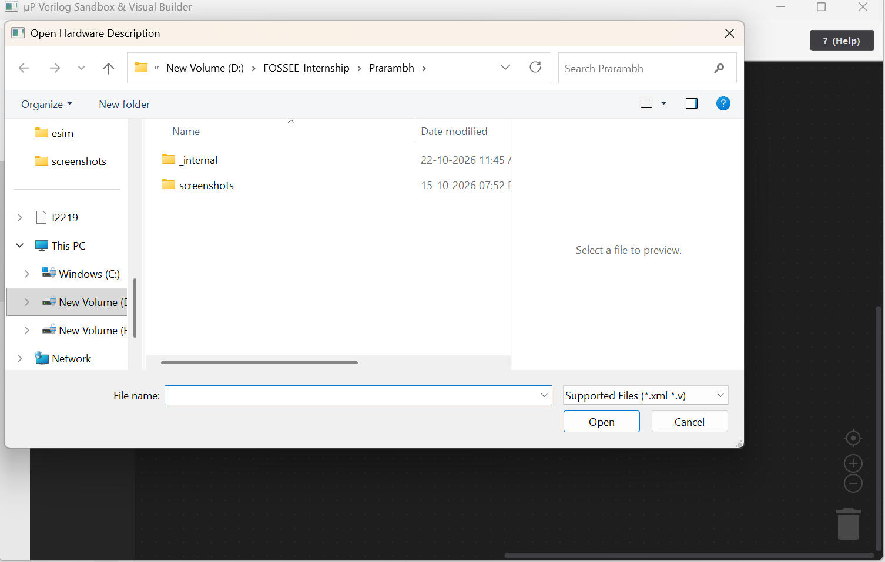

* **Purpose**: Access local drives, external project directories, and repository storage to locate digital design files.
* **Supported File Types**: Filters for `.xml` (visual graph schemas) and `.v` (Verilog HDL source files).

### 2.2 Navigating Internal Environment Assets

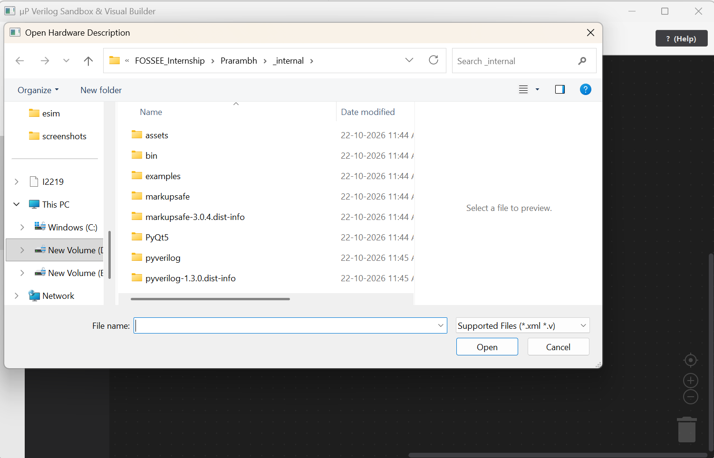

* **Purpose**: Inspect the application directory tree containing core assets:
  * `assets/`: UI graphics, fonts, and widget layouts.
  * `bin/`: Simulation toolchains and backend compilers.
  * `examples/`: Bundled Verilog learning modules and reference designs.
  * `pyverilog/`: Verilog parsing, elaboration, and syntax engine.
* **File Preview**: Displays the raw text content of selected files directly in the right pane before opening.

### 2.3 Selecting the Target Verilog File

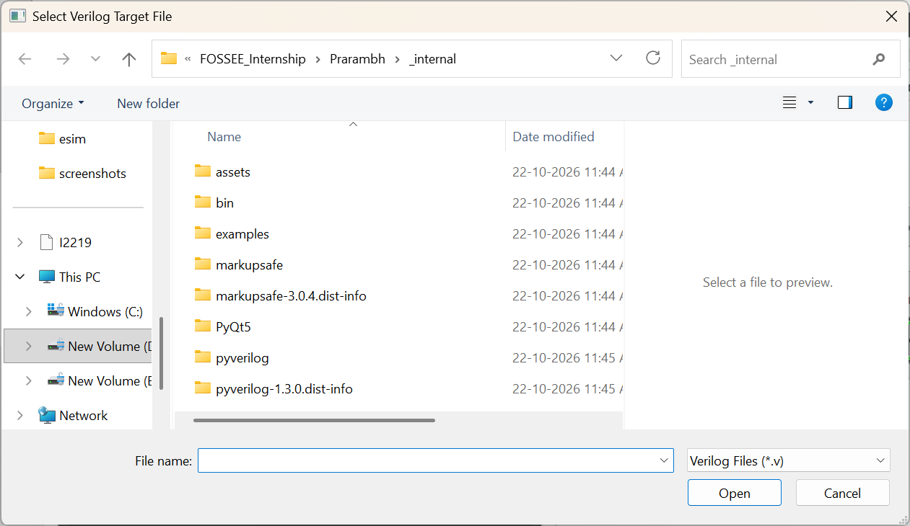

* **Purpose**: Locks the simulator onto a specific `.v` file for active compilation and simulation.
* Once confirmed, the top status bar updates to show the loaded module (e.g., `Target: example_memory_region.v`).

---

## 3. Loading Built-in Example Circuits

If you do not have custom Verilog code ready, select from the built-in library of working examples.

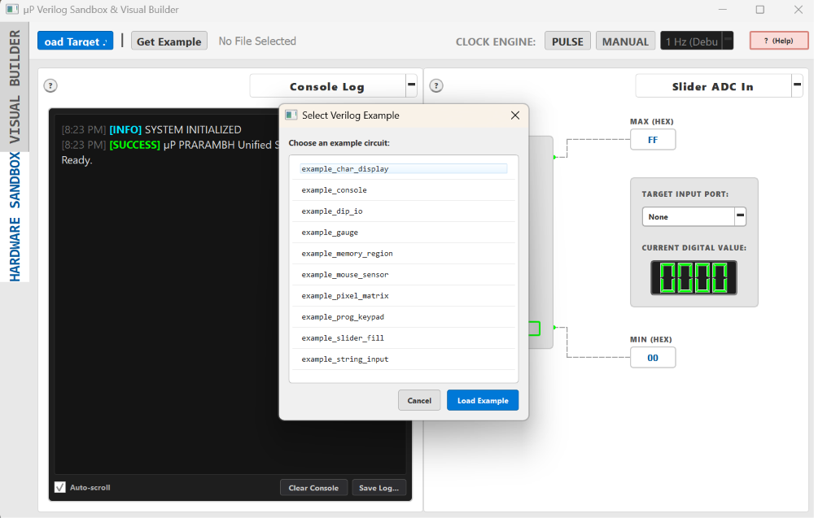

### Purpose & Available Circuits:
Click **Get Example** to open the catalog modal and choose an example:
* **`example_char_display`**: ASCII text matrix decoder and LCD emulator.
* **`example_console`**: Serial terminal printing and `$display` log parsing.
* **`example_dip_io`**: Multi-bit DIP switch bank to LED status register verification.
* **`example_gauge`**: Analog meter driving and PWM signal deflection.
* **`example_memory_region`**: SRAM/ROM block read, write, and index operations.
* **`example_mouse_sensor`**: 2D pointer displacement and quadrature encoder inputs.
* **`example_pixel_matrix`**: Framebuffer matrix memory mapping and pixel manipulation.
* **`example_prog_keypad`**: Matrix keypad scanning, debouncing, and keycode decode.
* **`example_slider_fill`**: ADC level monitoring and linear bar graph fill.
* **`example_string_input`**: Serial UART packet assembly and string buffer parsing.

Click **Load Example** to load the selected circuit directly into the workbench.

---

## 4. Visual Logic Modeling (Visual Builder)

Switch to the **VISUAL BUILDER** tab from the left sidebar to graphically construct and wire digital circuits.

### 4.1 Empty Workspace & Category Palette

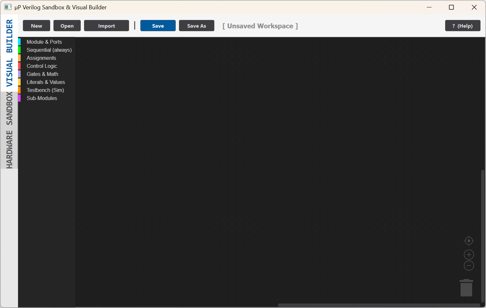

* **Top Toolbar Actions**:
  * **New**: Clears the canvas for a blank project (`[ Unsaved Workspace ]`).
  * **Open / Import**: Opens existing graphical block diagrams (`.xml`).
  * **Save / Save As**: Serializes block logic directly into synthesizable Verilog source (`.v`).
* **Drawer Categories (Left Strip)**:
  * **Module & Ports**: Define module headers, clock/reset nets, and I/O widths.
  * **Sequential (always)**: Flip-flops, edge-triggered always blocks (`always @(posedge clk)`).
  * **Assignments**: Continuous assignments (`assign`) and procedural updates (`<=`).
  * **Control Logic**: Decision trees (`if`/`else`) and state decoding (`case`/`endcase`).
  * **Gates & Math**: Primitive logic gates, comparators, arithmetic adders, and bit-shifters.
  * **Literals & Values**: Multi-radix bit constants (Decimal, Hexadecimal, Binary).
  * **Testbench (Sim)**: Simulation harnesses, delays (`#`), and initial blocks.
  * **Sub-Modules**: Instantiation of user-defined sub-circuits.
* **Canvas Tools (Bottom Right)**: Pan, zoom in (`+`), zoom out (`-`), center view, and canvas trash can.

### 4.2 Building Circuit Logic (FSM & Memory Example)

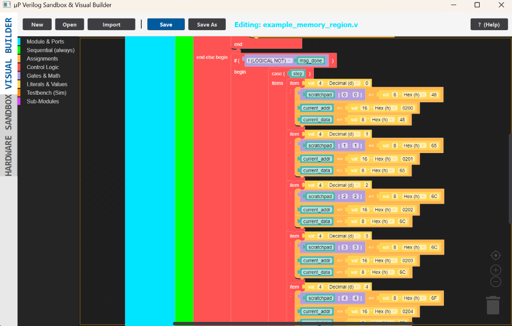

* **Active File**: Highlights current target (`Editing: example_memory_region.v`).
* **State Logic Example Shown**:
  * **Branch Guard**: Evaluates `if (! (LOGICAL NOT) msg_done)`.
  * **State Machine (`case (step)`)**: Drives addresses and data bytes on each step cycle:
    * `step 0`: Writes byte `0x48` ('H') into address `0x0200`.
    * `step 1`: Writes byte `0x65` ('e') into address `0x0201`.
    * `step 2`: Writes byte `0x6C` ('l') into address `0x0202`.
    * `step 3`: Writes byte `0x6C` ('l') into address `0x0203`.
    * `step 4`: Writes byte `0x6F` ('o') into address `0x0204`.
  * **Scratchpad Storage**: Simultaneously writes index bits to internal scratchpad registers.

---

## 5. Configuring Virtual Peripherals (Workbench Slot Management)

Return to the **HARDWARE SANDBOX** view. The workbench provides two modular slots, each configured independently via a drop-down menu.

### 5.1 Configuring Left Slot Widget

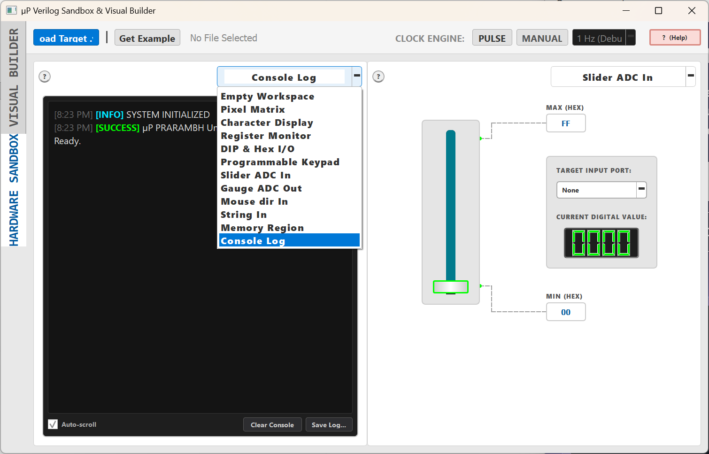

* **Purpose**: Assign the left panel to an output display or trace monitor.
* Available Widgets: `Empty Workspace`, `Pixel Matrix`, `Character Display`, `Register Monitor`, `DIP & Hex I/O`, `Programmable Keypad`, `Slider ADC In`, `Gauge ADC Out`, `Mouse dir In`, `String In`, `Memory Region`, and `Console Log`.

### 5.2 Configuring Right Slot Widget

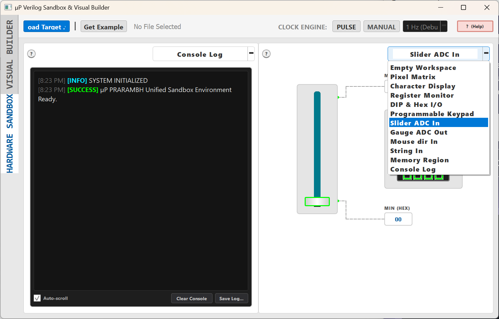

* **Purpose**: Assign the right panel to interactive inputs, stimuli, or auxiliary monitors.
* Selecting **Slider ADC In** attaches an analog slider input to drive target ports.

---

## 6. Hardware Wiring & Memory Diagnostics

Connect virtual inputs to module wires and verify live memory states.

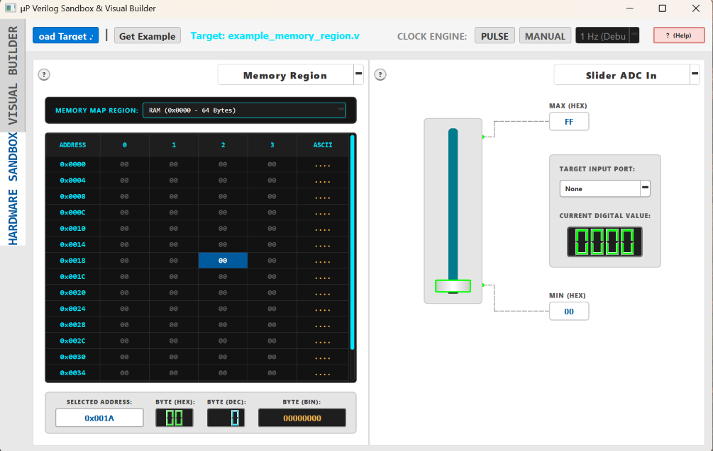

### Purpose & Configuration:
* **Slider ADC In (Stimulus)**:
  * **MIN (HEX)** / **MAX (HEX)**: Sets the conversion range (e.g., `00` to `FF`).
  * **TARGET INPUT PORT**: Dropdown binding the slider value directly to top-level Verilog input ports.
  * **CURRENT DIGITAL VALUE**: 7-segment digital display showing the instantaneous hexadecimal bus output.
* **Memory Region (Inspection)**:
  * **MEMORY MAP REGION**: Selects active memory space (e.g., `RAM (0x0000 - 64 Bytes)`).
  * **Memory Grid**: Displays address offset columns (`0`, `1`, `2`, `3`) and the translated **ASCII** character column.
  * **Selected Address Inspector**: Clicking cell `0x001A` decodes the stored value into:
    * **BYTE (HEX)**: `00`
    * **BYTE (DEC)**: `0`
    * **BYTE (BIN)**: `00000000`

---

## 7. Clock Engine Control & Simulation Stepping

Drive the hardware clock to execute state changes and inspect transitions.

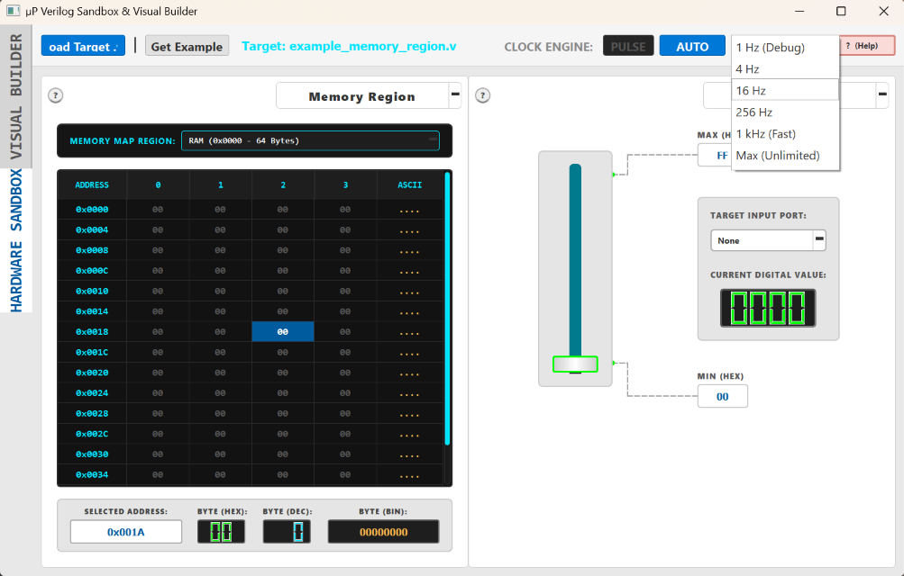

### Purpose & Controls:
* **PULSE**: Issues a single manual clock pulse (`posedge clk`). Use this to advance one machine cycle at a time and trace state transitions step-by-step.
* **Execution Modes**:
  * **MANUAL**: Pauses automatic clock cycling so all advancement is controlled via user stimuli or single pulses.
  * **AUTO**: Continuously advances the clock at the selected frequency preset.
* **Frequency Dropdown Presets**:
  * **`1 Hz (Debug)`**: 1 cycle per second; ideal for human observation of register states and debugging.
  * **`4 Hz` / `16 Hz`**: Slow automated execution for counter verification.
  * **`256 Hz`**: Real-time speed for multiplexed visual matrices and keypad scanning.
  * **`1 kHz (Fast)`**: High-speed execution for large memory transfers and math routines.
  * **`Max (Unlimited)`**: Uncapped clock rate driven by maximum host CPU capacity.
